# AdaRace

A driving simulator in Ada and GtkAda, in the spirit of Assetto Corsa, made for
a Logitech G29 (the keyboard works too): circuits and a rally stage, a driving
school, night, weather and seasons.

> **Built with AI.** Nearly all of this project was written by
> [Claude](https://www.anthropic.com/claude) Opus 5.5, Anthropic's AI model, working in
> Claude Code from the author's prompts. The AI wrote the code, shaders, tests
> and documentation; the author set the direction, drove the game on a real wheel and reported
> what felt right and what was broken. See [How this was made](#how-this-was-made).

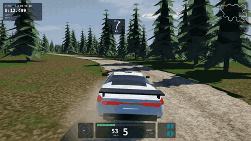

| | |
|---|---|
| 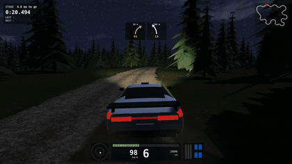 | 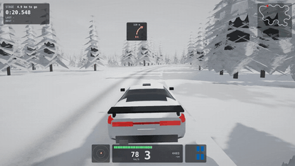 |
| Night, on the headlamps | Winter, snow falling |
| 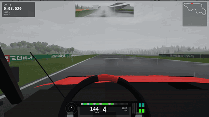 | 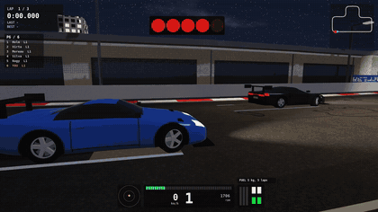 |
| Rain, from the cockpit | The start of a race against the AI |
| 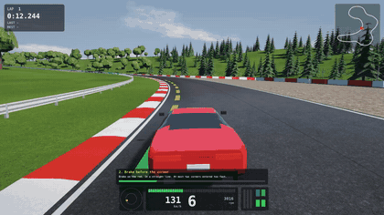 | 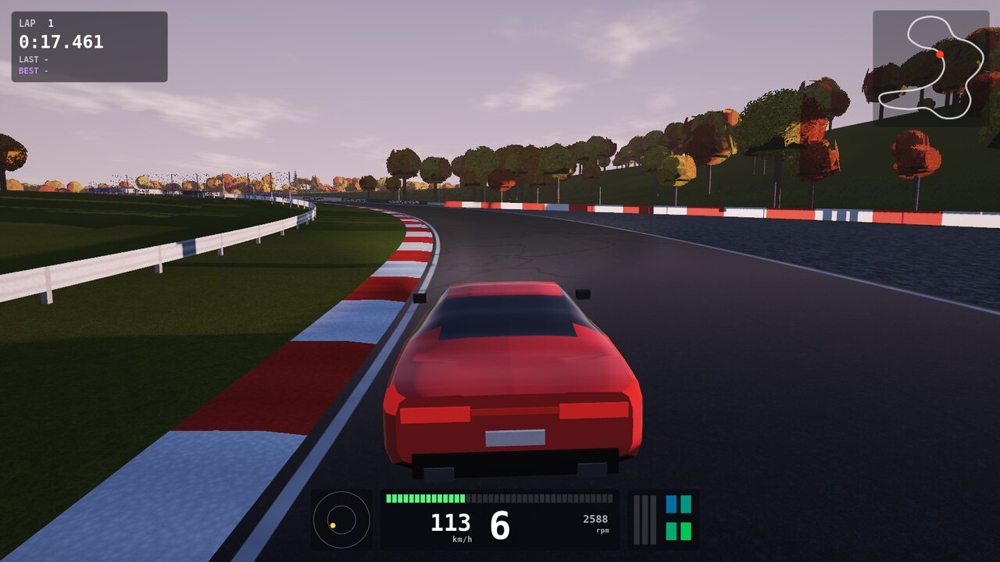 |
| The driving school and its coloured line | Autumn at dawn |
| 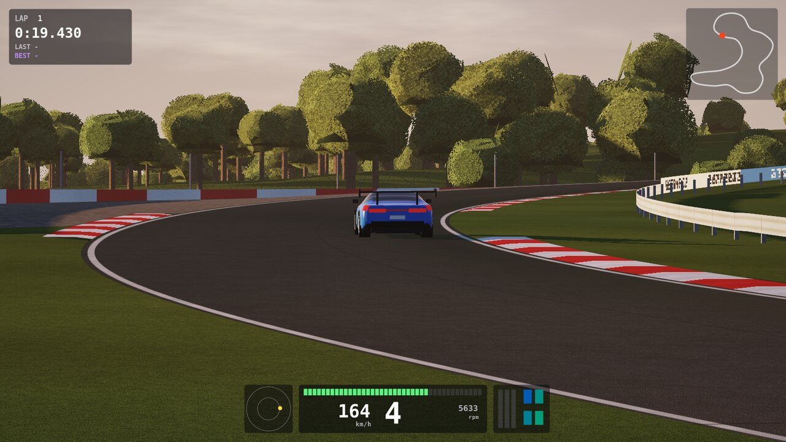 | 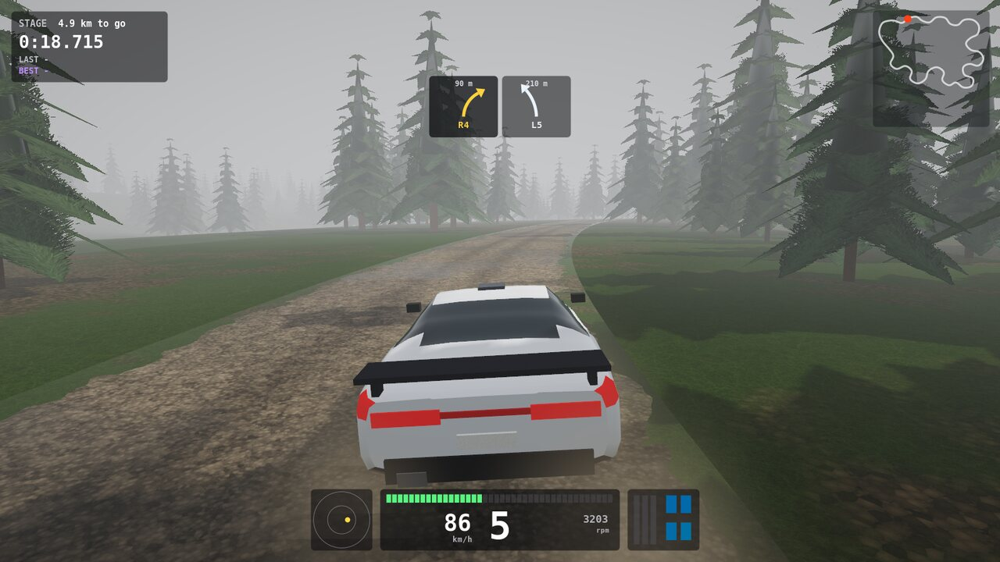 |
| A GT3 in the golden hour | Fog on the stage |
| 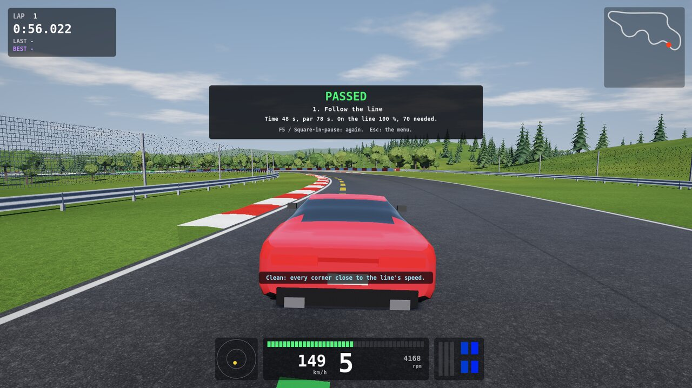 | 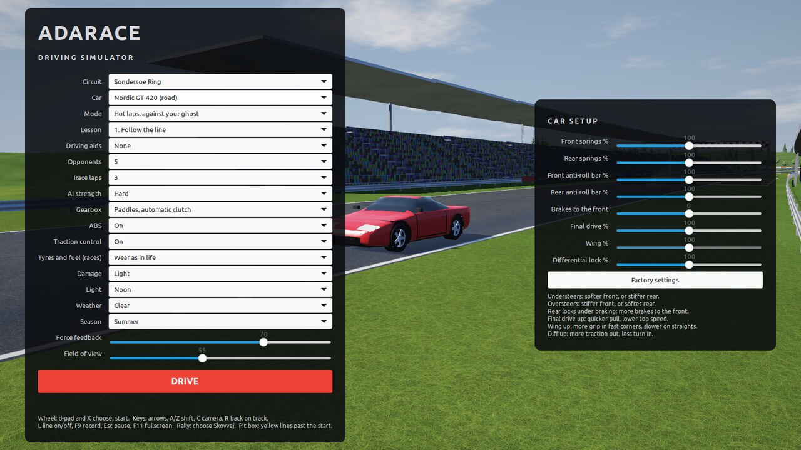 |
| A lesson passed, with the coach's word | The menu and car setup |

All of it is the game itself with the AI driver at the wheel, made by
`scripts/make_media.sh`.

## Getting started

    make run

Needs GNAT, gprbuild, GtkAda, libepoxy, PulseAudio and OpenGL 4.5.

## How this was made

AdaRace is an experiment in how far AI-led development can go on a real-time program in
Ada. Development was a conversation: the author asked for something ("let's do rally", "shall
we add weather?"), and Claude designed it, wrote it, tested it and reported back.

- **The AI's part:** the architecture, nearly all of the code, the physics and its tuning,
  the procedural graphics, the automated tests and this README.
- **The human's part:** the idea and the priorities, the driving, the bug reports and the
  judgement of how it feels, which no test can give. The stuck co-driver arrow and the
  look-back button that could not be undone were both found this way.
- **Reused code:** the G29, OpenGL and window layers began as code from the author's earlier
  driving project, and were extended here.

Code is checked by `make test` and by screenshots, but much of the tuning has had little
human driving yet, so expect rough edges. Commits made by the AI are marked with a
`Co-Authored-By` line.

## The simulation

Physics run at 1 kHz in an Ada task of their own, independent of the frame rate.

- **Tyres**: combined slip through a magic formula, carcass relaxation, load
  sensitivity, a temperature that changes the grip, and less grip on kerbs,
  grass and gravel.
- **Body**: four sprung corners with dampers and anti-roll bars, so weight
  moves under braking, acceleration and cornering. Elevation and banking act
  on the car, and aerodynamic drag and downforce grow with speed.
- **Drivetrain**: a torque curve, clutch, six gears, a limited slip
  differential. ABS and traction control are optional.
- **Force feedback**: comes from the aligning torque of the front tyres, so the
  wheel goes light at the limit, with kerbs, road surface and impacts on top.
  Sent at 125 Hz.

Three cars: a road GT, a GT3 with slicks and wings, and a four wheel drive rally car.
Three circuits: Søndersø Ring (4.9 km), Monte Ferro (3.2 km, 64 m of climb) and Kalvø
Speedway (3.2 km, banked oval), and the Skovvej forest rally stage (about 5 km).

Hot laps against the ghost of your best lap, which is kept per car and circuit
in `~/.local/share/adarace`, or races against up to seven AI cars on the same
physics. A lap with all four wheels off the track does not count.

## Controls

| Wheel | Keyboard | |
|---|---|---|
| Steering, pedals | Arrow keys | drive |
| Paddles | A / Z | shift up / down |
| H-shifter | | choose an H-shifter gearbox in the menu |
| L3 | Space | handbrake |
| | X (hold) | reverse, automatic gearbox |
| Triangle | C | camera: cockpit, hood, chase, far chase, trackside |
| Share | V | mirror |
| | G | ghost |
| | H | panels |
| | L | driving line |
| Square | R | back on the track (the lap is lost; +15 s on a stage) |
| + / - or dial | + / - | force feedback strength |
| R3 (press again for the front) | W (hold) | look back |
| | Q / E (hold) | look left / right |
| | [ / ] | field of view |
| Options | Esc | pause; then F5 / Square restarts, F10 / Circle goes to the menu |
| | F11 | fullscreen |
| | F9 | record a video, F9 again stops (saved in `~/Videos/AdaRace`, needs ffmpeg) |

In the menu the d-pad moves between rows and changes values, and X starts.
Choices are remembered in `~/.adaracerc`.

## Checks

`make test` runs without a window or wheel: a parked car stays parked, standing
start and braking figures are believable, the gearbox modes work, the steering
pulls the right way, barriers hold, and the AI gets round every circuit.

`make wheel` shows what the wheel reports and applies no force.

`ADARACE_NOWHEEL=1` leaves the wheel alone. `ADARACE_SELFTEST=1` together with
`ADARACE_AUTOSTART=1` walks through pause, restart, menu, change of circuit and
car, and drives again by itself.

## Telemetry and tuning

Every drive is logged at 100 Hz and written as CSV when it ends, to
`~/.local/share/adarace/telemetry/` (the newest 20 files are kept). It holds
inputs, speed, slip, tyre loads and temperatures, steering torque and the force
sent to the wheel.

`bin/catch` (built by `make test`) measures how forgiving slides are: a simulated
driver with a 0.2 s reaction time overcooks a corner and countersteers. Handling
values can be tried without rebuilding, e.g. `bin/catch shape=1.25,rear_mu=1.15`.

If frame pacing misbehaves, `ADARACE_FRAME_SYNC=1` restores GTK's compositor
handshake, which is off by default because it halved the frame rate in testing.

## Graphics

Surfaces are painted by the program at start-up (`src/textures.adb`), so there are
no image files: asphalt aggregate, grass blades, gravel, and cut-out leaf and pine
cards, all with mipmaps. `shaders/world.frag` adds bump, tar snakes, corrugated
Armco, advert boards and the cars' wheel arches and door lines; `shaders/post.frag`
does bloom, tone mapping and grading.

## Setup, wear, fuel, damage and pit stops

The panel on the right of the menu sets springs, anti-roll bars, brake balance, final
drive, wing (GT3) and differential, remembered for each car. They apply to your car
only; the AI runs factory settings.

In races, tyres wear and fuel burns (menu: off, normal, three times as fast). Hot laps
always run on fresh tyres, so laps stay comparable. Hits damage aero, engine and steering
(off, light, full), and going back on the track with R mends nothing. To repair and
refuel, stop in the pit box: the yellow lines left of the road just past the start line.
The HUD darkens each tyre as it wears and shows fuel and damage.

## Rally

Choose *Skovvej (rally stage)* as the circuit and, ideally, the *Nordic R4*. The stage is
about 5 km of gravel road through a forest, timed from the lights to the finish arch.

- **Loose surface:** tyres peak at far more slip with little drop past it, so slides can
  be held. Grip depends on the tyre: the R4's gravel tyres are the best, slicks the worst.
- **Nordic R4:** four wheel drive with a centre differential and long-travel suspension.
- **Co-driver:** arrows at the top of the screen, read from the road's shape: L/R, then
  1 (hairpin) to 6 (nearly flat), LONG, and crests. Next corner on the left.
- **Trees are solid** and hurt the car. R puts you back on the road at +15 s and repairs
  nothing. Short cuts don't count: the stage only finishes along the road.

The road continues beyond the finish back to the start (it closes the loop in the data),
but a stage ends at the finish, and the marshals brake the car.

## Driving school and coach

Mode *Driving school* has six lessons with measured goals: following the line, braking,
slow in fast out, catching a slide, staying on gravel and the whole stage. A lesson sets
its own circuit and car and saves no records. F5 tries again.

*Driving aids* in the menu turn on the driving line in any mode (L toggles it): dashes on
the road, green below the speed the line allows, yellow near it, red above it. With the
coach on, a tip after each lap names the corner that cost most. The line's speeds are the
AI's, so a good driver can beat them.

## Light, weather and seasons

- **Light:** morning, noon, golden hour, overcast, dawn, dusk and night, with headlamps.
- **Weather:** clear, rain, fog and snow. Rain and snow change the grip for every car and
  the AI's speeds; slicks suffer most in the wet, the R4 least on snow. Laps in rain, fog,
  snow or winter keep their own records.
- **Seasons:** summer, autumn colours, winter (snow on everything; rain falls as snow) and
  spring blossom. Winter grips like snow even under a clear sky.

## Development

`main` should always build and pass `make test`. Work happens on a branch per feature or
fix (`feature/spoken-co-driver`, `fix/wiper-blade`), merged through a pull request.

## Licence

MIT: see [LICENSE](LICENSE).

## How this was made

AdaRace is an experiment in how far AI-led development can go on a real-time program in
Ada. Development was a conversation: the author asked for something ("let's do rally", "shall
we add weather?"), and Claude designed it, wrote it, tested it and reported back.

- **The AI's part:** the architecture, nearly all of the code, the physics and its tuning,
  the procedural graphics, the automated tests and this README.
- **The human's part:** the idea and the priorities, the driving, the bug reports and the
  judgement of how it feels, which no test can give. The stuck co-driver arrow and the
  look-back button that could not be undone were both found this way.
- **Reused code:** the G29, OpenGL and window layers began as code from the author's earlier
  driving project, and were extended here.

Code is checked by `make test` and by screenshots, but much of the tuning has had little
human driving yet, so expect rough edges. Commits made by the AI are marked with a
`Co-Authored-By` line.

## The simulation

Physics run at 1 kHz in an Ada task of their own, independent of the frame rate.

- **Tyres**: combined slip through a magic formula, carcass relaxation, load
  sensitivity, a temperature that changes the grip, and less grip on kerbs,
  grass and gravel.
- **Body**: four sprung corners with dampers and anti-roll bars, so weight
  moves under braking, acceleration and cornering. Elevation and banking act
  on the car, and aerodynamic drag and downforce grow with speed.
- **Drivetrain**: a torque curve, clutch, six gears, a limited slip
  differential. ABS and traction control are optional.
- **Force feedback**: comes from the aligning torque of the front tyres, so the
  wheel goes light at the limit, with kerbs, road surface and impacts on top.
  Sent at 125 Hz.

Three cars: a road GT, a GT3 with slicks and wings, and a four wheel drive rally car.
Three circuits: Søndersø Ring (4.9 km), Monte Ferro (3.2 km, 64 m of climb) and Kalvø
Speedway (3.2 km, banked oval), and the Skovvej forest rally stage (about 5 km).

Hot laps against the ghost of your best lap, which is kept per car and circuit
in `~/.local/share/adarace`, or races against up to seven AI cars on the same
physics. A lap with all four wheels off the track does not count.

## Controls

| Wheel | Keyboard | |
|---|---|---|
| Steering, pedals | Arrow keys | drive |
| Paddles | A / Z | shift up / down |
| H-shifter | | choose an H-shifter gearbox in the menu |
| L3 | Space | handbrake |
| | X (hold) | reverse, automatic gearbox |
| Triangle | C | camera: cockpit, hood, chase, far chase, trackside |
| Share | V | mirror |
| | G | ghost |
| | H | panels |
| | L | driving line |
| Square | R | back on the track (the lap is lost; +15 s on a stage) |
| + / - or dial | + / - | force feedback strength |
| R3 (press again for the front) | W (hold) | look back |
| | Q / E (hold) | look left / right |
| | [ / ] | field of view |
| Options | Esc | pause; then F5 / Square restarts, F10 / Circle goes to the menu |
| | F11 | fullscreen |
| | F9 | record a video, F9 again stops (saved in `~/Videos/AdaRace`, needs ffmpeg) |

In the menu the d-pad moves between rows and changes values, and X starts.
Choices are remembered in `~/.adaracerc`.

## Checks

`make test` runs without a window or wheel: a parked car stays parked, standing
start and braking figures are believable, the gearbox modes work, the steering
pulls the right way, barriers hold, and the AI gets round every circuit.

`make wheel` shows what the wheel reports and applies no force.

`ADARACE_NOWHEEL=1` leaves the wheel alone. `ADARACE_SELFTEST=1` together with
`ADARACE_AUTOSTART=1` walks through pause, restart, menu, change of circuit and
car, and drives again by itself.

## Telemetry and tuning

Every drive is logged at 100 Hz and written as CSV when it ends, to
`~/.local/share/adarace/telemetry/` (the newest 20 files are kept). It holds
inputs, speed, slip, tyre loads and temperatures, steering torque and the force
sent to the wheel.

`bin/catch` (built by `make test`) measures how forgiving slides are: a simulated
driver with a 0.2 s reaction time overcooks a corner and countersteers. Handling
values can be tried without rebuilding, e.g. `bin/catch shape=1.25,rear_mu=1.15`.

If frame pacing misbehaves, `ADARACE_FRAME_SYNC=1` restores GTK's compositor
handshake, which is off by default because it halved the frame rate in testing.

## Graphics

Surfaces are painted by the program at start-up (`src/textures.adb`), so there are
no image files: asphalt aggregate, grass blades, gravel, and cut-out leaf and pine
cards, all with mipmaps. `shaders/world.frag` adds bump, tar snakes, corrugated
Armco, advert boards and the cars' wheel arches and door lines; `shaders/post.frag`
does bloom, tone mapping and grading.

## Setup, wear, fuel, damage and pit stops

The panel on the right of the menu sets springs, anti-roll bars, brake balance, final
drive, wing (GT3) and differential, remembered for each car. They apply to your car
only; the AI runs factory settings.

In races, tyres wear and fuel burns (menu: off, normal, three times as fast). Hot laps
always run on fresh tyres, so laps stay comparable. Hits damage aero, engine and steering
(off, light, full), and going back on the track with R mends nothing. To repair and
refuel, stop in the pit box: the yellow lines left of the road just past the start line.
The HUD darkens each tyre as it wears and shows fuel and damage.

## Rally

Choose *Skovvej (rally stage)* as the circuit and, ideally, the *Nordic R4*. The stage is
about 5 km of gravel road through a forest, timed from the lights to the finish arch.

- **Loose surface:** tyres peak at far more slip with little drop past it, so slides can
  be held. Grip depends on the tyre: the R4's gravel tyres are the best, slicks the worst.
- **Nordic R4:** four wheel drive with a centre differential and long-travel suspension.
- **Co-driver:** arrows at the top of the screen, read from the road's shape: L/R, then
  1 (hairpin) to 6 (nearly flat), LONG, and crests. Next corner on the left.
- **Trees are solid** and hurt the car. R puts you back on the road at +15 s and repairs
  nothing. Short cuts don't count: the stage only finishes along the road.

The road continues beyond the finish back to the start (it closes the loop in the data),
but a stage ends at the finish, and the marshals brake the car.

## Driving school and coach

Mode *Driving school* has six lessons with measured goals: following the line, braking,
slow in fast out, catching a slide, staying on gravel and the whole stage. A lesson sets
its own circuit and car and saves no records. F5 tries again.

*Driving aids* in the menu turn on the driving line in any mode (L toggles it): dashes on
the road, green below the speed the line allows, yellow near it, red above it. With the
coach on, a tip after each lap names the corner that cost most. The line's speeds are the
AI's, so a good driver can beat them.

## Light, weather and seasons

- **Light:** morning, noon, golden hour, overcast, dawn, dusk and night, with headlamps.
- **Weather:** clear, rain, fog and snow. Rain and snow change the grip for every car and
  the AI's speeds; slicks suffer most in the wet, the R4 least on snow. Laps in rain, fog,
  snow or winter keep their own records.
- **Seasons:** summer, autumn colours, winter (snow on everything; rain falls as snow) and
  spring blossom. Winter grips like snow even under a clear sky.

## Development

`main` should always build and pass `make test`. Work happens on a branch per feature or
fix (`feature/spoken-co-driver`, `fix/wiper-blade`), merged through a pull request.

## Licence

MIT: see [LICENSE](LICENSE).
